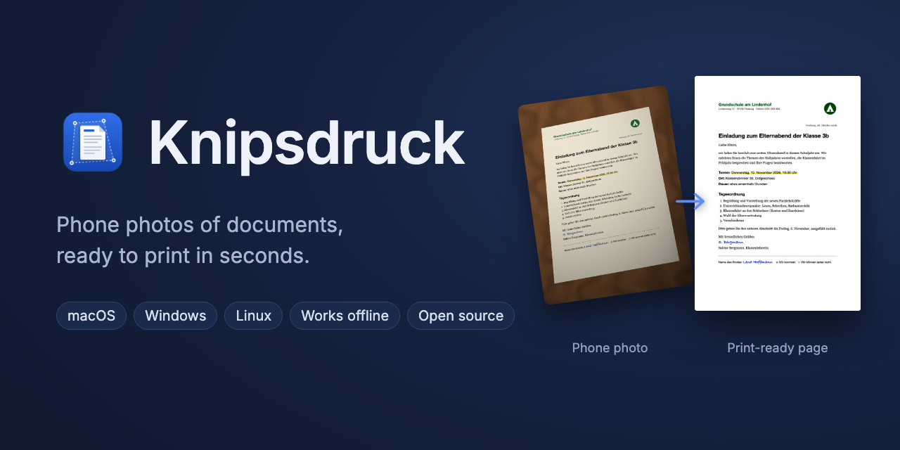
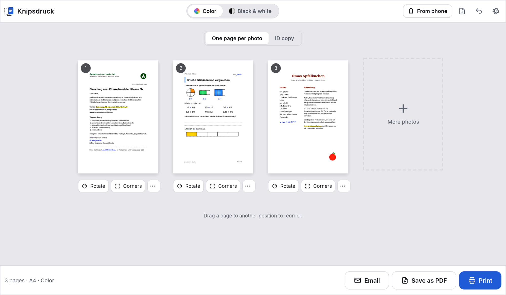
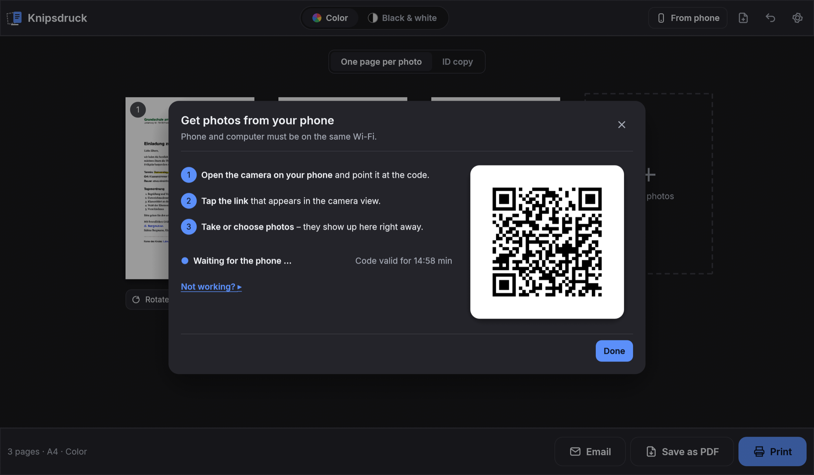
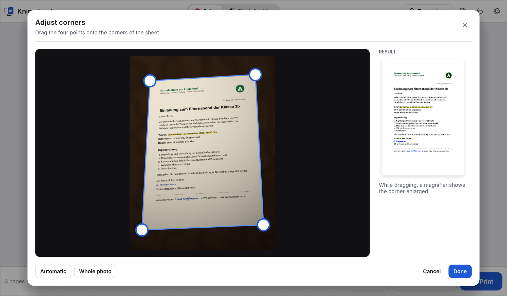

<p align="center"></p>

**Phone photos of documents, ready to print.** Someone sends you a worksheet, a letter or a form as a
photo, and you need it on paper. Knipsdruck finds the sheet in the photo, straightens it, evens out the
lighting and turns the background white, so the result looks like a photocopy instead of a picture of
a desk. Then print it, save it as a PDF or send it by email.

A desktop app for macOS, Windows and Linux, written in Rust. Everything runs on your computer: no
account, no cloud, no AI service.



> **Status: first release (0.1).** Sheet detection has been developed on real phone photos, including
> sheets lying on a binder or on top of other sheets. If a page is marked *Please check*, the corners can be
> adjusted by hand. Feedback with (anonymized) photos where detection fails is very welcome.
> See the [changelog](CHANGELOG.md).

## Features

- **Finds the sheet automatically** and corrects the perspective. Pages where the detection is unsure are
  marked; drag the four corners into place with a magnifier, or use the whole photo.
- **Looks like a copy:** shadows and uneven light are removed, paper becomes white, writing stays crisp.
  Color or black and white (grayscale like a copier, or pure black and white to save toner).
- **Get photos from your phone** without cables or apps: Knipsdruck shows a QR code, the phone opens a small
  upload page on your local Wi-Fi and the original photos appear right away.
- **Paper sizes** A3, A4, A5, A6, B5, US Letter, US Legal or a custom size in millimeters; portrait,
  landscape or automatic per page. A sheet is fitted onto the page, never distorted.
- **ID copy:** front and back of an ID card at actual size (85.6 × 54 mm) on one sheet.
- **Print, save as PDF or email** – all pages, or a single page from its menu. PDFs come in print quality
  (300 dpi) or a small version for email.
- **Searchable PDFs** (optional): text recognition with the engine built into each system (Apple Vision,
  Windows OCR, Tesseract on Linux) adds an invisible text layer.
- **Recently used:** the last ten documents stay available for 30 days to print again or change. ID copies
  are never kept. Can be switched off.
- Drag and drop, paste from the clipboard, reorder pages by dragging, rotate, undo and redo.
- User interface in English and German, light and dark.



## Installation

Download the latest version from the [releases page](https://github.com/eckonator/knipsdruck/releases).

**macOS** (Apple Silicon and Intel). The easiest way is to paste this into Terminal:

```sh
curl -fsSL https://raw.githubusercontent.com/eckonator/knipsdruck/main/scripts/install-macos.sh | bash
```

It installs the newest release into `/Applications`. Alternatively open the `.dmg` and drag Knipsdruck to
Applications. The app is not notarized by Apple, so macOS blocks the first launch from the `.dmg`: open
*System Settings → Privacy & Security* and click *Open Anyway*. The install command above avoids this step.

**Windows** (64-bit): run `Knipsdruck-…-Windows-Setup.exe`. It installs for the current user without admin
rights and adds Knipsdruck to the Start menu. The `-Windows.zip` is a portable version: unpack it anywhere
and start `Knipsdruck.exe`.

**Linux** (x86_64): unpack the `.tar.gz` and start `knipsdruck`, or run `./install.sh` to add it with its
icon to the application menu (per user; `./install.sh --uninstall` removes it). Printing uses CUPS. For
searchable PDFs install Tesseract, e.g. `sudo apt install tesseract-ocr tesseract-ocr-eng tesseract-ocr-deu`.

**Updates:** with the update check switched on (asked on first start, also in the settings), Knipsdruck
shows a bar when a new version is out. **Update now** downloads and installs it and restarts the app. On
macOS the new app is only accepted if it is signed with the same certificate as the installed one; on Windows
the new installer runs silently; on Linux this works when installed with `./install.sh`.

## Usage

1. Drop photos onto the window, choose them with **Choose photos …**, paste them, or use **Get from phone**.
2. Check the pages. **Corners** adjusts the detected sheet, **Rotate** turns a page, drag pages to reorder.
3. Choose **Color** or **Black & white** at the top and press **Print**.

| Key (macOS) | Windows / Linux | Action |
|---|---|---|
| <kbd>⌘O</kbd> | <kbd>Ctrl+O</kbd> | Choose photos |
| <kbd>⌘V</kbd> | <kbd>Ctrl+V</kbd> | Paste a photo from the clipboard |
| <kbd>⌘⇧H</kbd> | <kbd>Ctrl+Shift+H</kbd> | Get photos from the phone |
| <kbd>⌘P</kbd> | <kbd>Ctrl+P</kbd> | Print |
| <kbd>⌘S</kbd> | <kbd>Ctrl+S</kbd> | Save as PDF |
| <kbd>⌘Z</kbd> / <kbd>⌘⇧Z</kbd> | <kbd>Ctrl+Z</kbd> / <kbd>Ctrl+Y</kbd> | Undo / redo |
| <kbd>⌘,</kbd> | <kbd>Ctrl+,</kbd> | Settings |
| <kbd>R</kbd>, <kbd>E</kbd>, <kbd>←</kbd> <kbd>→</kbd> | same | In the large preview: rotate, adjust corners, previous / next page |



## Getting photos from the phone

Phone and computer have to be on the same network. While the dialog is open, Knipsdruck runs a small web
server on your computer; the QR code contains its local address and a random key that is valid for this
session only. The server accepts nothing but images from devices in the local network, stops after 15 minutes
without activity and as soon as the dialog is closed.

The connection uses plain HTTP inside your own network (HTTPS would need certificates that phones warn about).
Use it at home or in the office, not in public Wi-Fi. If the phone cannot reach the computer:

- Make sure the phone uses Wi-Fi, not mobile data. Guest networks often keep devices apart.
- Allow Knipsdruck when the firewall asks. On Windows, installing *for all users* adds a rule for private
  networks.
- Under *Not working?* the dialog lists other network addresses of the computer to try.

## Privacy

- Your photos never leave your computer, except over your local network from your own phone. Detection,
  processing and text recognition run locally.
- Recently used documents are stored in the settings folder (`zuletzt/`) for at most 30 days and can be
  deleted at any time in the settings. ID copies are never stored.
- The only internet request is an optional check for new versions on GitHub. Knipsdruck asks before
  enabling it; it sends nothing about your photos or settings.
- No telemetry, no account.

## Building

You need a current Rust toolchain ([rustup.rs](https://rustup.rs)). On Linux you also need the
X11/Wayland development packages, e.g. on Debian/Ubuntu:

```sh
sudo apt install libxkbcommon-dev libwayland-dev libx11-dev libxcursor-dev libxrandr-dev libxi-dev libgl1-mesa-dev pkg-config
```

```sh
cargo run -p knipsdruck       # starts the app
cargo test --workspace        # runs the tests
cargo xtask demo-fotos        # generates sample phone photos of fictional documents into demo/ (needs Chrome)
```

The command line tool does the same without a window:

```sh
knipsdruck-cli pdf --grau -o out.pdf photo1.jpg photo2.jpg   # grayscale PDF, A4
knipsdruck-cli ecken photo1.jpg                               # print the detected corners
```

## Architecture

| Part | Purpose |
|---|---|
| `crates/core` | Loading, sheet detection, perspective correction, lighting, page layout. No GUI or platform code, fully tested. |
| `crates/pdf` | Writes the pages as PDF (JPEG images, optional invisible text layer). |
| `crates/print` | Printing, email with attachment and *show in folder* on macOS, Windows and Linux. |
| `crates/phone` | Local upload server, QR code and the phone page. |
| `crates/ocr` | Text recognition with the engine built into each system. |
| `cli` | `knipsdruck-cli` for scripting and debugging. |
| `app` | The user interface (egui). |
| `xtask` | Developer tools (`cargo xtask …`). |

Code comments are in German; issues and contributions in English are welcome.

## License

Copyright © 2026 Markus Eckert

Licensed under either of

- Apache License, Version 2.0 ([LICENSE-APACHE](LICENSE-APACHE))
- MIT license ([LICENSE-MIT](LICENSE-MIT))

at your option. The bundled Inter font is licensed under the SIL Open Font License 1.1.
